# edaloop

An evidence-gated design loop for circuit boards, built for AI agents and the people who review their work.

edaloop joins open tools (atopile, KiCad, KiCadRoutingTools, Freerouting, ngspice, circuitRF, openEMS, Palace and EMerge) into one loop. Each tool answers the question it's best at. edaloop records every answer against the exact files it measured, and at any moment it can say what to do next.

**Status: prototype.** It has run on a handful of RF boards on one Mac, and AI agents have driven it in benchmarks. Nothing it has laid out has been fabricated or measured. Review its output yourself before you send anything to a fab.

## Why it exists

A clean DRC says a board is connected and meets its clearances. It says nothing about impedance, current or whether the ground under an RF line is whole. An agent also reports what it remembers, and that can go stale after one edit.

- **Evidence is tied to bytes.** Each result records a hash of what it measured, so saving the board retires every claim about the old one.
- **One authority per question.** KiCad owns DRC, for example. [AUTHORITY.md](edaloop/docs/AUTHORITY.md) gives each choice and the failure behind it.
- **Routers are held to your rules.** They work on copies, and any rule they rewrite is put back before grading.
- **Nets are routed by class.** RF goes first, then power, then signals. See [routing-classes.md](edaloop/docs/routing-classes.md).
- **RF review lessons are built in.** That covers welded ground vias, makers' via patterns, a 70 mil fence and supply on an inner layer. See [rf-layout-rules.md](edaloop/docs/rf-layout-rules.md).
- **Solvers check each other.** With three EM solvers, an outlier is named, and its error pattern suggests the setup fault.
- **People own the decisions.** Requirements and waivers can't be changed through the agent tools, and a waiver needs a name and a reason.

## How data moves

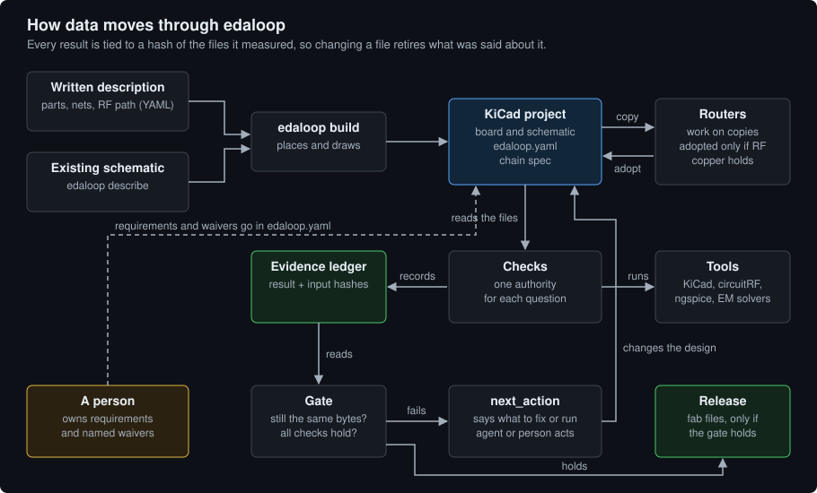

## The stages

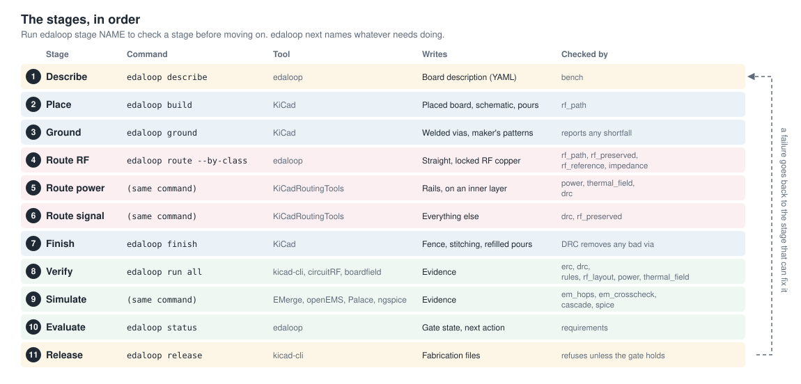

## One board, step by step

These figures are real output from [`gain_block_demo.yaml`](edaloop/testbenches/gain_block_demo.yaml), a two-stage 900 MHz to 1.5 GHz gain block. It's a demonstration board that has never been built, and its parts' values are typical ones. [`build_figures.py`](edaloop/docs/figures/build_figures.py) draws the figures from a run.

### 1. Describe

A description is a short YAML file with the parts, nets and RF path. Write one by hand, or get one from an existing schematic. edaloop marks what it assumed and what it needs from you.

```bash
edaloop describe board.kicad_sch -o board.yaml --band-mhz 900 1500
```

```bash
edaloop bench
```

`bench` checks the description itself, with no KiCad files: connectivity, the RF path, the cascade and the DC bias.

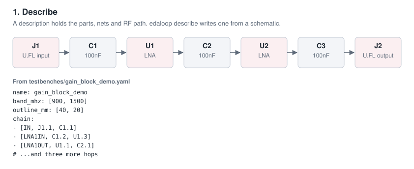

### 2. Place

```bash
edaloop build testbenches/gain_block_demo.yaml -o my_board
```

This draws the schematic, proves it against the description, and adds the pours. Rotations and positions come from the nets and courtyards, so the RF pads land on one line.

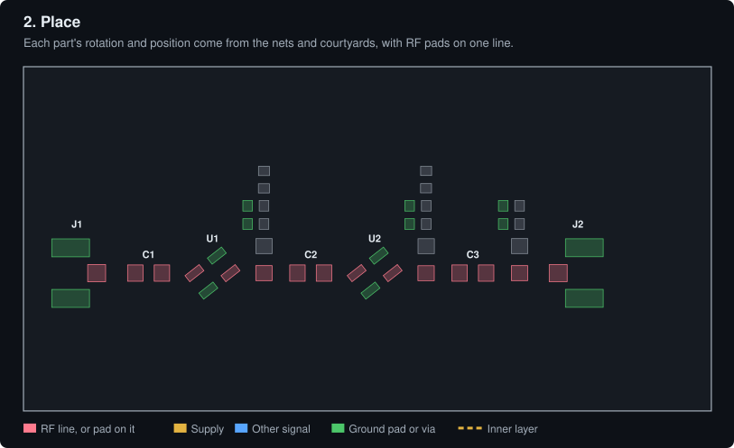

### 3. Ground

```bash
edaloop -C my_board ground
```

This welds a via to each ground pad before anything routes. The via's ring overlaps the pad, and its hole stays outside so solder can't wick into it. Known parts get their maker's pattern.

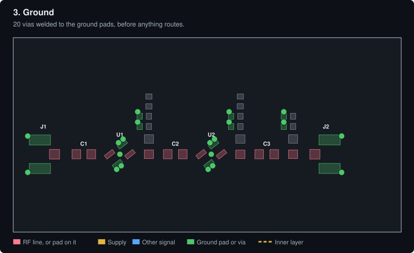

### 4 to 6. Route, by class

```bash
edaloop -C my_board route --by-class
```

RF is laid first, straight and locked, with no vias.

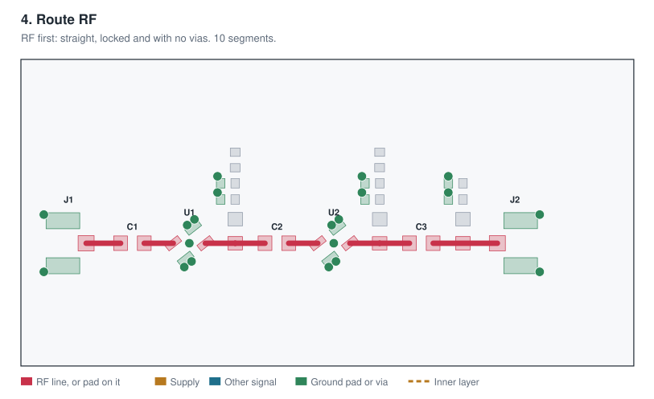

Power follows. The top layer costs more, so supply runs inside.

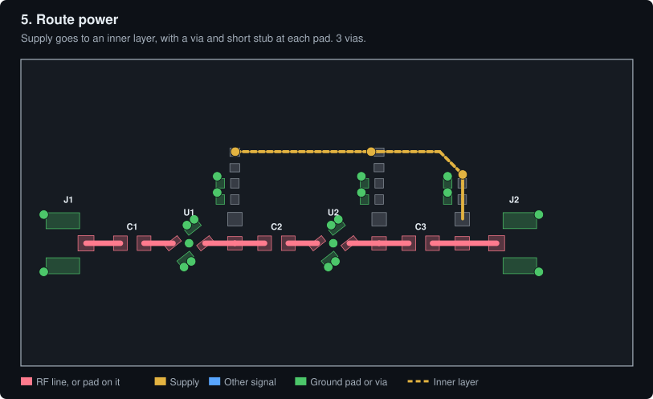

Signals come last, and no router can use the plane under the RF line.

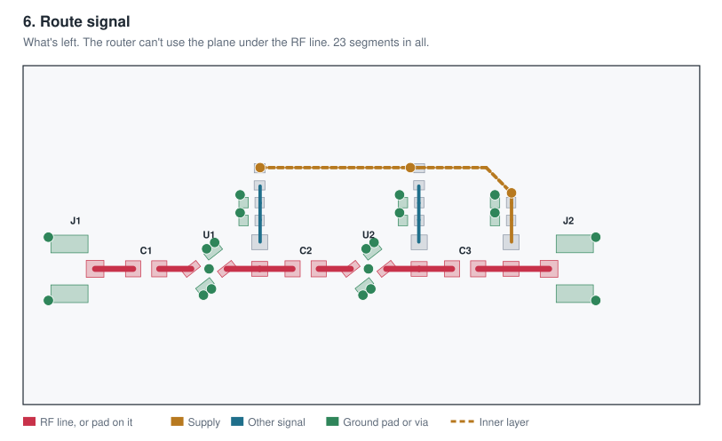

### 7. Finish

```bash
edaloop -C my_board finish
```

This adds the fence along the RF line, stitches the pours and refills them. KiCad's DRC has the last word on each new via.

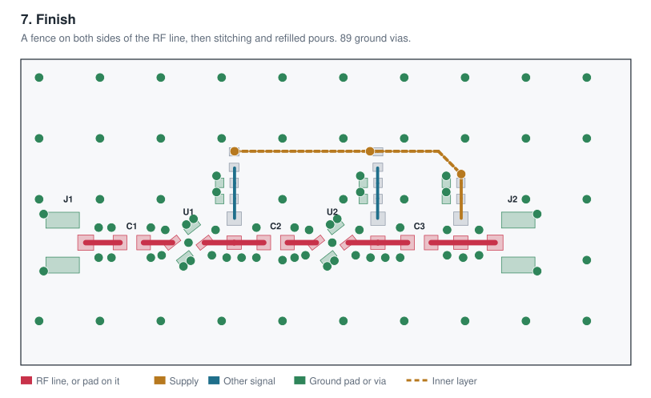

### 8. Verify

```bash
edaloop -C my_board run all
```

Each check runs its own authority and records the result. A result that's still current isn't run again.

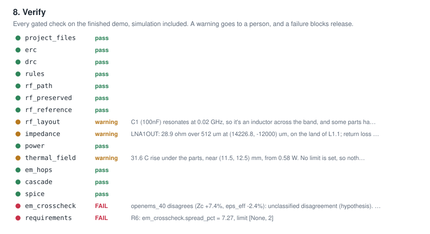

The demo doesn't pass, and that's the gate doing its job. The warnings are for a person to read, and the failures come from the solver disagreement in the next step.

### 9. Simulate

Each RF hop is solved as routed, with its pads. Three solvers then read the same line, and an outlier gets named rather than averaged in.

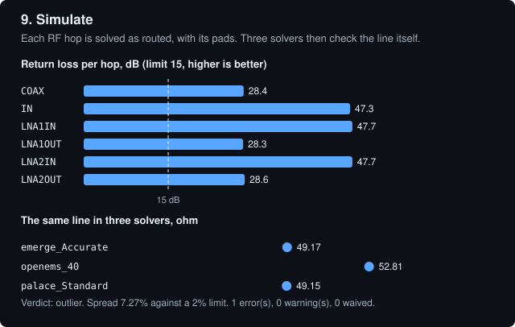

Here openEMS reads about 7% above the other two, and the 2D reference backs the other two. Refining its grid doesn't close the gap. See [openems-coupon-bias.md](edaloop/docs/openems-coupon-bias.md).

### 10. Evaluate

`next` is what an agent loops on. When a decision belongs to a person, it stops and says so. On the demo, it asks whether to waive the openEMS disagreement or hold the release.

```bash
edaloop -C my_board next
```

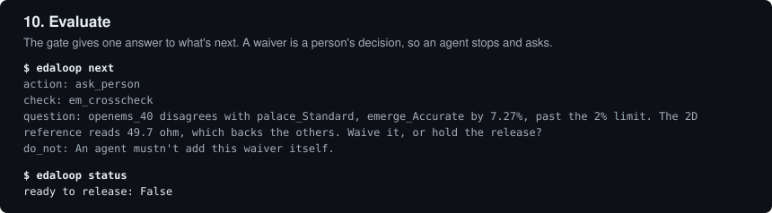

### 11. Release

```bash
edaloop -C my_board release
```

This exports fabrication files, only if every gated check holds on these exact bytes. `edaloop review` makes a pack for a person with renders, a BOM and fab notes, but no Gerbers.

### Handing off to other tools

```bash
edaloop -C my_board export
```

This writes the board in KiCad 6.0 and EAGLE 7.7 formats, for tools that can't read KiCad 10, and reads each back through KiCad to check that no net, pad or via changed. See [exports.md](edaloop/docs/exports.md). Neither format has been opened in Altium or EAGLE itself.

## Getting started

You need KiCad 10 and [uv](https://docs.astral.sh/uv/), plus Rust for `boardfield` and `boardhand`. `doctor` runs each external tool, reports what works, and tells you how to get the rest, including circuitRF and its solvers.

```bash
cd edaloop && uv sync && uv run edaloop doctor --fix
```

Try it with no KiCad files:

```bash
uv run edaloop bench
```

Or take the demo through the whole flow. `--quick` leaves out the three-solver EM check, so its result can't be released:

```bash
uv run edaloop make testbenches/gain_block_demo.yaml -o my_board --quick
```

For your own KiCad project, run these in its folder:

```bash
edaloop init
```

```bash
edaloop next
```

[`edaloop/README.md`](edaloop/README.md) lists every command, and [board-description.md](edaloop/docs/board-description.md) covers descriptions and placement. AI agents use the MCP server and [`SKILL.md`](edaloop/src/edaloop/agent/SKILL.md).

## What's in this repository

| Folder | What it is | Language |
|---|---|---|
| [`edaloop/`](edaloop/README.md) | The loop: evidence ledger, gate, checks, placement, by-class routing and MCP server | Python |
| [`boardfield/`](boardfield/README.md) | Current and temperature fields on a board's own copper, pours included | Rust, WGSL |
| [`boardhand/`](boardhand/README.md) | Guarded board edits over MCP, with revision checks and recoverable writes | Rust |
| [`edaloop/testbenches/`](edaloop/testbenches) | Board descriptions that run with no KiCad files | YAML |
| [`edaloop/evaluation/`](edaloop/evaluation/README.md) | 20 open production boards to test edaloop against, fetched at pinned commits | YAML |
| [`AGENTS.md`](AGENTS.md) | Instructions for AI coding agents working on this repository. `CLAUDE.md` links to it | Markdown |

No real board files are stored here. [Evaluation boards](edaloop/evaluation/README.md) stay in their own repositories under their own licences.

## Known limits

- **The placer isn't general.** It lays out RF cascades with taps and bias rails, one row per channel, and packs other parts on a shelf for the router.
- **Two test benches need your own land patterns.** `lband_element` and `cband_element` run through `bench`, but they can't be built without footprints for their custom RF parts. `gain_block_demo` uses only KiCad's standard ones.
- **Readings aren't measurements.** Part heat is an upper estimate, and stackups and heights are assumed unless you state them. Nothing has been held against a bench.
- **openEMS reads high on narrow coplanar lines.** Refining its grid doesn't close the gap, and the cause is unknown. See [openems-coupon-bias.md](edaloop/docs/openems-coupon-bias.md).
- **Some layout rules are measured, not enforced.** The router isn't forbidden from an RF part's pad gap, a limiter's pad field or a run alongside an RF line, though `rf_layout` reports each.

## Tests

```bash
cd edaloop && uv run --extra dev pytest
```

```bash
cd boardfield && cargo build --release
```

```bash
cd boardhand && cargo test
```

`boardfield` has an accuracy suite against closed forms, run from `edaloop/`:

```bash
uv run python benchmarks/thermal_validate.py /tmp/field-check
```

`boardhand`'s fixture tests skip unless `BOARDHAND_FIXTURE_SMALL` and `BOARDHAND_FIXTURE_LARGE` name KiCad boards. Any board works for the small one; the checks of the original private board's exact contents run only with `BOARDHAND_FIXTURE_SMALL_IS_ORIGINAL` set. CI uses the `gain_block_demo` board. Its tests check what it writes with KiCad when they find it, at macOS paths by default; set `BOARDHAND_TEST_KICAD_CLI` and `BOARDHAND_TEST_KICAD_PY` to use another install.

CI's `kicad` job runs the parts that need KiCad 10, in KiCad's own Docker image: `edaloop doctor`, the Python tests, a build and export of `gain_block_demo`, and `boardhand`'s tests against real `kicad-cli` and `pcbnew`.

## Acknowledgements

`boardhand` is inspired by [Konnect](https://github.com/mixelpixx/Konnect): replies that report what was observed, guarded writes, and a router round trip that can't lose copper. It's a separate implementation written from [its own spec](boardhand/SPEC.md).

## Licence

[MIT](LICENSE). The tools this drives have their own licences, and they run as separate programs. Palace's build includes ParMETIS, which limits commercial use. Check each tool's terms before relying on it commercially.
