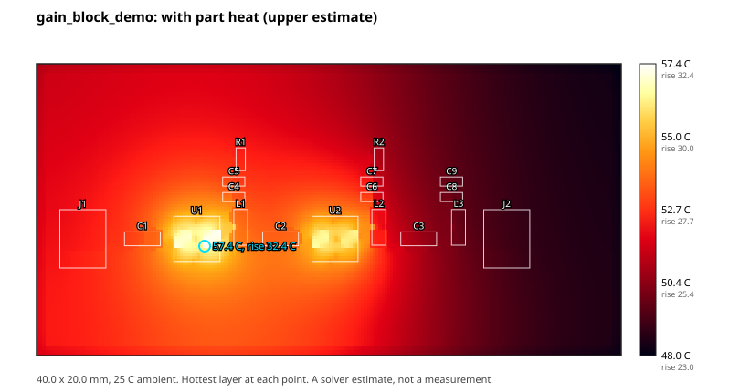

# Feature test: the testbench boards

This is a run of every edaloop step that the available tools allow on the testbench boards, with what each one produced. It's here to show what a run looks like, and to record what this exercise found and fixed. Every reading here is a solver estimate, not a measurement. The first sections are from placed but unrouted boards; [Routed run](#routed-run) is from a later run with the routers and EM solvers built.

## Setup

KiCad 10.0.8, `pcbnew` and ngspice 44.2 ran from KiCad's Docker image (`kicad/kicad:10.0.8`), through small wrapper scripts named in `~/.config/edaloop/toolchain.yaml`. `boardfield` was built from this repository. circuitRF and KiCadRoutingTools were not built, so nothing was routed. See [Requirements](../../README.md#requirements).

## What ran

### gain_block_demo

| Step | Result | Notes |
|---|---|---|
| `build` | Placed 18 parts on a 40 × 20 mm board | |
| `ground` | 36 ground vias, none short of target. 5 on each of the four U.FL ground pads, where there was 1 | KiCad's DRC raises no placement objection to any of them |
| `project_files` | pass | |
| `erc` | pass | Was 18 warnings before the fix below |
| `drc` | fail: 19 unconnected, and 28 silkscreen overlaps | Expected: nothing is routed. `ground.finish` places silkscreen after routing |
| `rf_layout`, `rf_reference` | fail, RF nets unrouted | Were warn and pass before the fix below |
| `spice` | pass | Bias bench: 116 mA in total, 5.00 V at both LNAs |
| `cascade` | pass | 32.8 to 36.8 dB gain and at most 0.97 dB noise figure over 900 to 1500 MHz, from the stage table alone. With no copper, no line loss is included, and the evidence says so |
| `power` | fail, VDD doesn't reach R1 and R2 | Expected: unrouted |
| `thermal_field` | fail, VDD unrouted. 32.4 C rise under U1 from part heat | The rise is an upper estimate (0.58 W, still air, no conduction out through connectors). No `max_part_rise_c` is set, so nothing judges it. That limit is a person's decision |

### four_channel_demo

| Step | Result | Notes |
|---|---|---|
| `bench` | All pass: connectivity, the four RF chains, band edges, DC bias | Bias through ngspice: 232 mA in total, 5.00 V at each LNA |
| `build` | Placed 33 parts on a 27.2 × 40.1 mm board | |
| `ground` | 45 ground vias, none short of target | Before connector filling |
| `project_files`, `erc` | pass | |
| `cascade` | Per channel: 18.4 dB / NF 0.8 dB at 900 MHz, 16.4 dB / NF 0.95 dB at 1500 MHz | From the stage table this run added. It crashed before, with no table |
| `thermal_field` | 47.3 C rise under the parts from 1.16 W | An upper estimate, as above |
| `drc`, `rf_layout`, `rf_reference`, `power` | fail, unrouted | Expected |

### lband_element and cband_element

These pass `bench` (connectivity, the RF chain, the design table, band edges where given, and DC bias through ngspice). They can't be built, because their RF parts use land patterns (`RFLib_FP`, `CBandLib_FP`) that aren't in this repository.

lband_element was then run through `make` on a copy of its description, outside the repository, with its two missing land patterns pointed at KiCad's stock ones:
- `Filter:Filter_Mini-Circuits_FV1206` for the LFCN filters;
- `RF_Mini-Circuits:Mini-Circuits_TT1224_LandPatternPL-258_ClockwisePinNumbering` for the RLM limiter.

Their pad numbers match the description's nets, but neither footprint was checked against Mini-Circuits' own drawing, which this environment couldn't fetch. So these readings rest on KiCad's footprints.

| Check | Result |
|---|---|
| `erc`, `rf_path`, `rf_reference`, `power`, `spice`, `cascade` | pass. Power: 7.9 mV worst drop, 0.61 C rise |
| `drc` | fail: 6 `annular_width` errors, all on the stock FV1206's plated ground holes (0.155 mm ring against the board's 0.1778 mm) |
| `em_hops` | pass: all 8 hops. 30.7 dB worst return loss, on the two hops carrying a bias choke's land; 49.8 to 62.0 dB on the rest. 0.125 dB worst-case insertion loss along the chain |
| `rf_layout` | warn: two fence gaps at part pads, and the 100 nF series caps |
| `em_crosscheck` | error: Palace not installed |

cband_element still can't be built: KiCad has no land pattern for its MC1631-1 or DQ1225 parts.

That run found three edaloop faults, now fixed:
- **Vias on a footprint's own holes.** `ground` placed vias on top of the TT1224 pattern's own vias (4 co-located holes) and 0.16 to 0.18 mm from the filters' plated holes (18 hole-to-hole faults). Only other nets' pads were obstacles.
- **A pad's own clearance.** With those holes avoided, a via moved to 0.56 mm from the limiter's output, inside the 0.94 mm clearance the land pattern sets on that pad, and routing stopped. `ground` used the 0.2 mm net class everywhere.
- **The maker's pattern read as missing.** `rf_layout` then reported the maker's via rows as missing, because it counted only board vias, not a footprint's own plated ground holes.

The heat graph from `thermal_field` on gain_block_demo, with part heat:

## What it found, and what changed

- **RF checks passed with no RF copper.** `rf_layout` reported a warning and `rf_reference` a pass on a placed but unrouted board, because there was nothing to measure. Both now fail with `unrouted`, naming the RF nets that have no copper.
- **ERC warned about every footprint library.** `build` placed parts from KiCad's standard libraries but left the project's `fp-lib-table` empty. It now lists them through `${KICAD10_FOOTPRINT_DIR}`, and ERC is clean.
- **cascade crashed with no stage table.** On four_channel_demo it raised `min() iterable argument is empty`. It now fails with `cascade:no_stages`, saying what to add. The board also gained a stage table, so `cascade` is back in its gate.
- **`edaloop bench <name>` crashed.** It wanted a path. It now finds a shipped bench by name, and lists them when the name is wrong.
- **The heat map had no scale.** `boardfield`'s PNG was 200 × 100 pixels, coloured from 0 C, with no axes or labels. It now colours from the coolest cell to the hottest and reports that range (`png_rise_range_c`). `thermal_field` also writes an SVG with the board edge, each part, the hotspot, and a scale in C with the rise beside it.

## Routed run

A later run built circuitRF 1.7.0 with EMerge 3.0.0 and openEMS 0.37.0, and KiCadRoutingTools from source, then ran `edaloop make` on both demos. Palace wasn't installed.

| Check | gain_block_demo | four_channel_demo |
|---|---|---|
| `drc`, `erc`, `project_files` | pass | pass |
| `rf_path` | pass, within 0.01% of each hop's floor | pass, 41.20 mm routed against a 41.20 mm floor |
| `rf_reference`, `rf_preserved` | pass. Baseline for 6 RF nets | pass. Baseline for 16 RF nets |
| `impedance` | warn: 28.9 ohm over 512 um on each bias choke's land, 35 dB return loss at 1.575 GHz | the same, on all four channels |
| `rf_layout` | warn: the 100 nF series caps resonate near 0.02 GHz, below the band | the same, on all eight |
| `power` | pass | pass: 0.24 mm VDD, 9.99 C rise, 3.8 to 14.9 mV drop |
| `thermal_field` | warn: 31.6 C rise under the parts from 0.58 W, with no limit set | warn: 46.8 C from 1.16 W, with no limit set |
| `em_hops` | pass: every hop solved with its ground vias. Input hops about 48 dB return loss, output hops 28.6 dB, 0.112 dB worst-case insertion loss summed along the chain | pass: all 16 hops solved. 48.0 to 48.4 dB on input and coupling hops, 28.6 to 28.7 dB on the four amplifier outputs, 0.055 dB worst-case insertion loss per channel. 17 minutes on 4 cores |
| `em_crosscheck` | fail, `no_majority`, run with `em.solvers` cut to EMerge and openEMS: EMerge Accurate reads 49.17 ohm, openEMS 52.81 ohm, and the 2D reference 49.7 ohm | not run |
| `requirements` | fail, from `em_crosscheck` | fail, from `em_crosscheck` |

The output hops read lower than the rest because each one carries the bias choke's pad on the line, the low-impedance section `impedance` reports. All four channels read alike.

A later gain_block_demo run put each choke's land beside the line instead, 0.1 mm from its edge on a stub (`rf_layout.tap_stub_mm: 0.1`). `impedance` then passed, but `em_hops` read the three choke hops at 24.9 to 25.0 dB, 3.7 dB worse, with 0.149 dB summed insertion loss, and `rf_path` failed at 7.46% over its floor. DRC still passed, with 36 ground vias after `ground` and 102 on the finished board. So the default stays with the pad on the line, and a rerun with it repeated the table above exactly: 105 ground vias on the finished board. The reasons are in [Taps beside the line](rf-layout-rules.md#taps-beside-the-line). four_channel_demo wasn't rerun.

The cross-check result is the openEMS bias described in [openems-coupon-bias.md](openems-coupon-bias.md): the 2D reference backs EMerge, but two solvers can't outvote each other, so the check fails rather than pick one. A third solver, normally Palace, is what settles it. Before this run the check spent a full EMerge solve before failing on Palace's absence. It now refuses at once, naming the missing solver and how to install it.

## Not run, and why

- **A three-solver `em_crosscheck`:** Palace wasn't installed.
- **RF coupling between lines:** `rf_layout` measures parallel runs and pad-gap intrusions on routed copper. Coupling between separate lines isn't simulated: each `em_hops` model holds one line.
- **`rules`:** this needs a fabricator rule pack.
